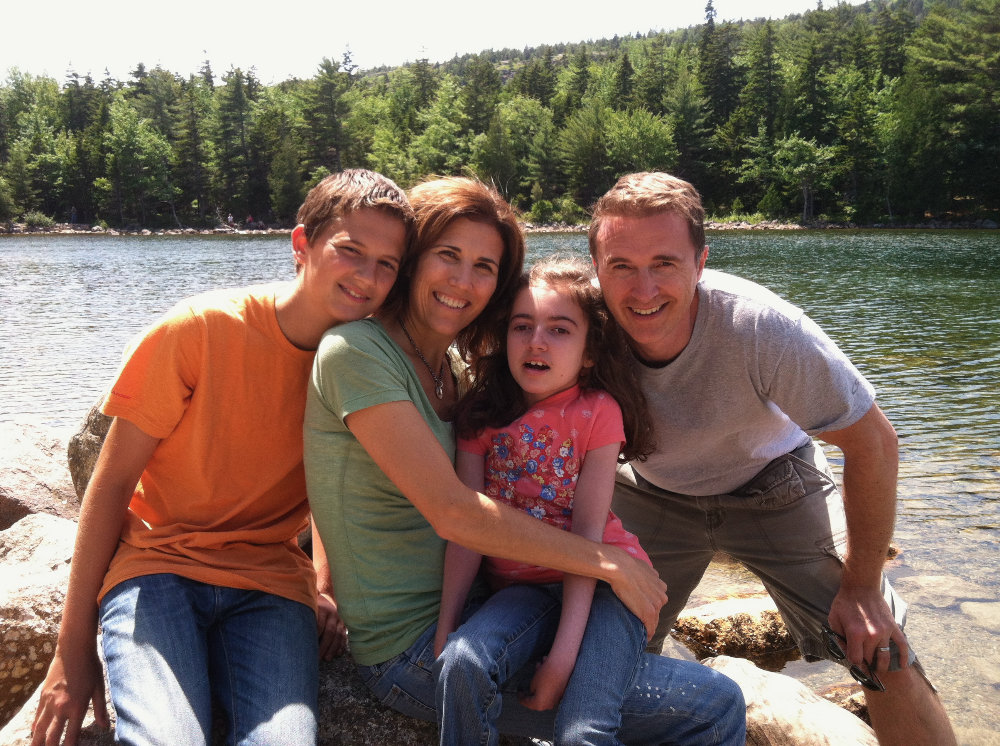
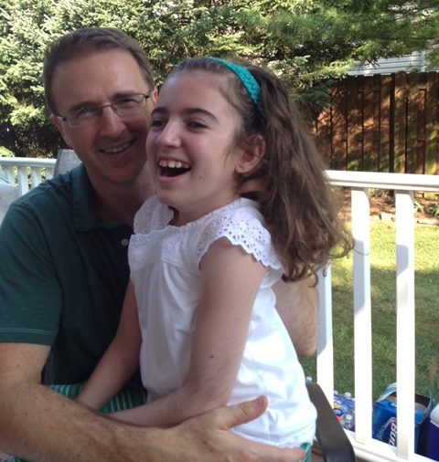
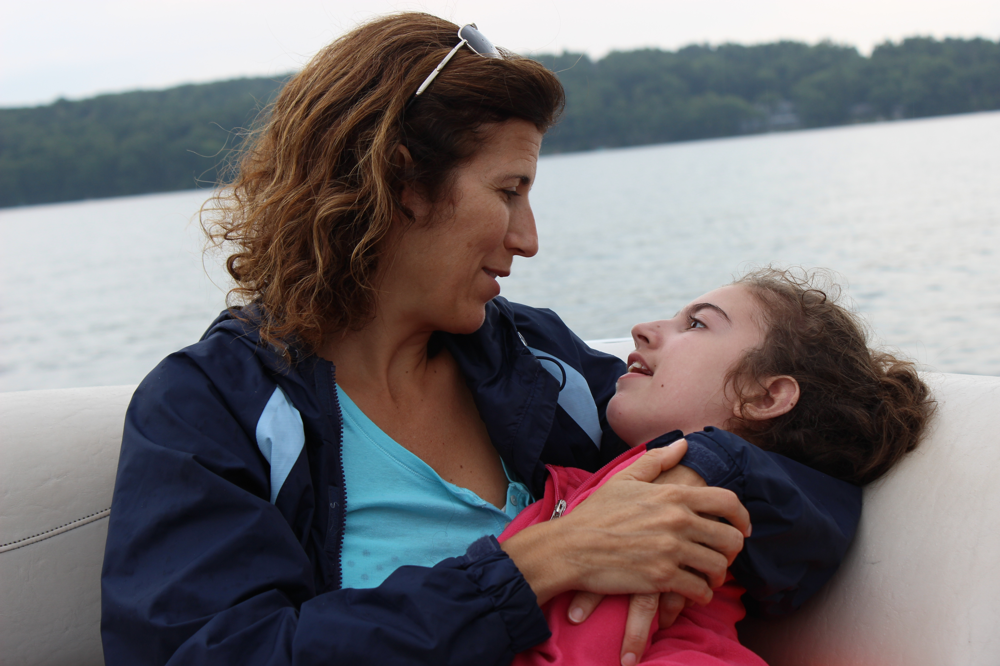
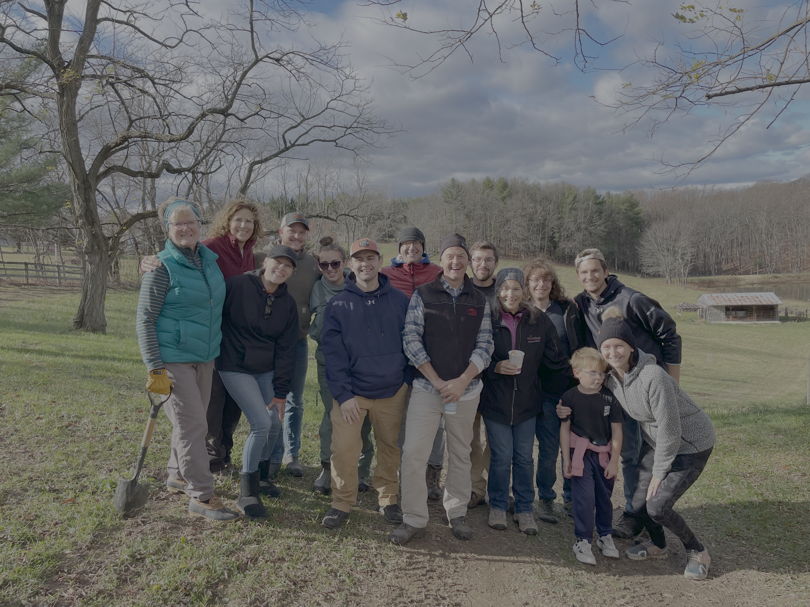

Many people ask us where we got the name Bold Love. There’s a story behind it. It’s not an easy one to tell, but it’s definitely worth sharing. So, friend, pull up a chair and let’s talk.

  

Our daughter Olivia was born with a rare and progressively debilitating disease. Caring for her and doing everything we could to give her the best possible life shaped our lives until she passed just a few days before her 16th birthday. That was 2018.

The pain and grief could have overwhelmed us. And sometimes it did. And sometimes it still does. But that would not honor Olivia and everything she taught us in her too-short life. Despite all she suffered, she never lost her spark, her exuberant laughter, her mischievous smile, her uncomplaining fortitude.

Physically, she could do very little, but wherever she went she touched people. She brought out their natural compassion, generosity, and love.

One time, we were flying to Utah for a family vacation. The flight attendant took amazing care of us and helped everything go smoothly.  As we were departing, he asked about our return flight and said he would try to rearrange his schedule to be on it. When we boarded the flight to go home, there he was!

Those are the kinds of acts of Bold Love Olivia inspired.

We wanted to find a way to carry that forward. Something so quiet, so fundamental as nurturing plants and feeding our community with wholesome food was a surprisingly fitting response.

All the nurturing and caring we had devoted to Olivia needed somewhere new to go, especially since our son Clay was heading to college. It was Bold to leave our careers, buy a farm, and start a bakery in a town where we knew no one.

But, caring for the Earth in the way we grow food, nourishing soil, plants, and people, and serving our community—these are the simple acts of Love that pay tribute to Olivia and the gift her life was to us.

The amazing thing is that her gift continues to give! We had no idea the community that would form around us when we started this venture. An amazing group of committed and caring people have supported us from the very beginning and it just keeps growing!

Friend, I know you have suffered too. Every life has its share. Perhaps that’s a small part of why you are here now—to be part of a community that cares for each other despite all the hurt. To us, that is one of the most healing and uplifting acts of Bold Love there is!

  

